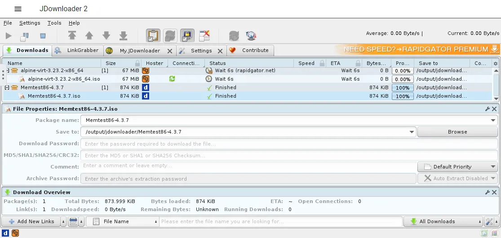

# JDownloader 2

Start the App and select **Open Web UI**. Home Assistant authenticates the browser session and forwards it through Ingress. Show the App in the sidebar for direct access.

## Downloads and configuration

| Purpose | In JDownloader | In Home Assistant |
| --- | --- | --- |
| Download directory | `/output/jdownloader` | `/share/jdownloader` |
| JDownloader settings and history | `/config` | Configuration folder for this App |

The download path is the default for a new installation. On an existing installation, check **Settings → General → Download Folder** in JDownloader. A package can also have its own destination. The App retains settings and queues through a restart or rebuild.

Before updating to `0.1.8`, check any custom destinations under `/output`. AppArmor restricts file access within that mount to `/output/jdownloader` and its subdirectories. Move existing files from other `/share` folders on the Home Assistant host and update affected package destinations in JDownloader as needed.

### SMB storage

1. In Home Assistant, open **Settings → System → Storage → Add network storage**.
2. Set **Name** to `jdownloader` and **Usage** to **Share**. Choose **Samba/Windows (CIFS)**.
3. Enter the SMB server under **Server**, the exported share name under **Remote share**, and the credentials for that export.
4. Start JDownloader. Download a small file and confirm its size on the SMB server after it reaches **Finished** in JDownloader.

The App also works with local storage under `/share/jdownloader`. Check the network storage state in Home Assistant if a finished file is missing on the server. Confirm the destination of the specific JDownloader package and verify that the mount points to the intended share. NFS compatibility requires validation on the target setup.

If you always use network storage, enable **Require SMB or NFS storage** in the App configuration and restart it. At startup, the App checks the filesystem behind `/output/jdownloader` and stops with a log message if SMB or NFS is unavailable. The option defaults to off for local storage. Stop the App before removing or changing the mount on a running system.

### CIFS write permissions

In the tested HA OS setup, the mounted volume appears as `root:root` with mode `0755`. JDownloader runs as UID/GID `0:0` inside the container to write there. Home Assistant mounts its full `/share` with read and write access at `/output`. Keep the AppArmor profile enabled so that the App can access files in the download directory while other folders on that mount are protected. Remote SMB permissions follow the credentials configured in Home Assistant.

If JDownloader reports **Invalid download directory**, check the share is mounted, the SMB account can write, and the package targets `/output/jdownloader`. Inspect the App logs for errors around `54-ha-output.sh` and `55-jdownloader2.sh`.

## Memory and archive extraction

To limit the Java heap, specify a single `-Xmx` value in the App's persistent `/config/JDownloader2.vmoptions` file, for example `-Xmx512m`, and restart the App. The appropriate value depends on your download queue and available RAM. Other parts of the App use memory in addition to the Java heap.

Automatic extraction from an SMB download folder reads the archive over the network and writes the extracted files back. You can disable automatic extraction in JDownloader if you prefer to extract the files on the storage server.

## MyJDownloader and captchas

You can link an existing account in JDownloader's MyJDownloader settings to manage downloads remotely. Some sites require a browser captcha. MyJDownloader and its browser extension can help complete supported challenges on a workstation. Account setup and remote access use the [MyJDownloader service](https://my.jdownloader.org/).

## Ingress or startup errors

If the web interface fails to open, check the App logs for Nginx startup errors and for `all services started`. Open the UI from Home Assistant. The Web server accepts requests through the Supervisor ingress gateway, and VNC TCP is disabled.

When updating, back up the App's configuration. Home Assistant uses a distinct App ID and configuration directory for each repository. The existing local App has ID `local_jdownloader`, and an installation from a GitHub repository will have its own configuration. Plan any transfer of settings while the two instances are stopped to avoid running the same queue twice.
