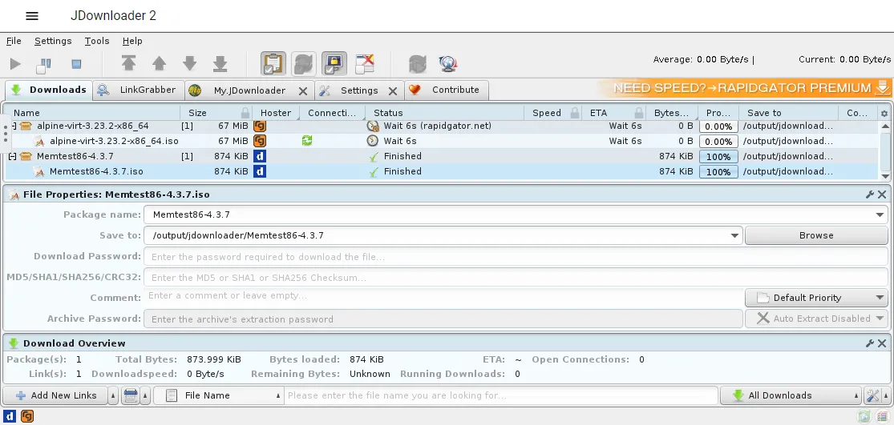

# JDownloader 2

Open the full JDownloader 2 desktop from Home Assistant. Choose **Open Web UI** to connect through Home Assistant Ingress.

New installations save downloads to `/output/jdownloader` in JDownloader. You can find them at `/share/jdownloader` in Home Assistant, or on the network share mounted at that location. Your JDownloader settings and download history live in the App's persistent configuration folder.

See [Documentation](DOCS.md) for storage setup and [Changelog](CHANGELOG.md) for release details. This App is maintained independently of the JDownloader and jlesage projects.
