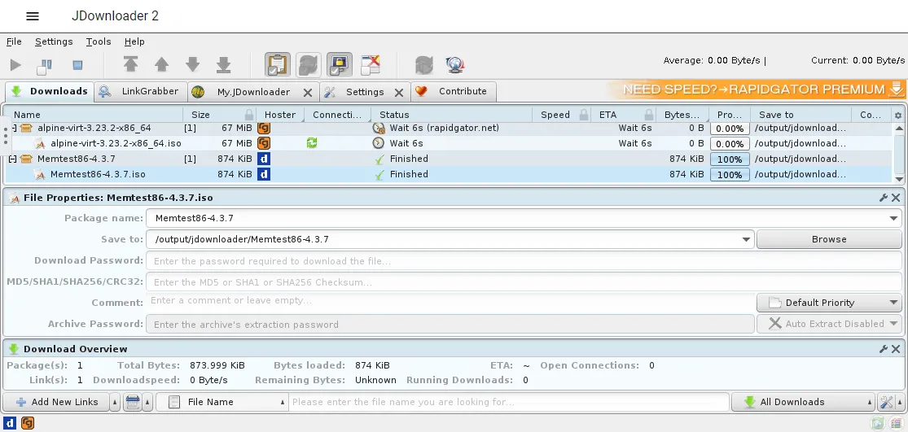

# JDownloader 2 Home Assistant App

[Repository overview](../README.md) · [Guide en français](fr.md)

## Install from the Home Assistant Store

1. In Home Assistant, open **Settings → Apps → Install app → Repositories**.
2. Add `https://github.com/r-jean-pierre/home-assistant-jdownloader-app`.
3. Select **JDownloader 2**, then click **Install** and **Start**.
4. From the App page, select **Open Web UI**. Enable **Show in sidebar** for quick access.

Home Assistant opens the desktop through Ingress. The App Store uses a pre-built image from GitHub Container Registry for your platform.

## Choose a download location

| What | Path |
| --- | --- |
| Default download destination in JDownloader | `/output/jdownloader` |
| Matching location on Home Assistant | `/share/jdownloader` |
| Persistent App settings and history | `/config` |

For local storage, leave the default destination in JDownloader. Check the destination of an individual package if it saves to another folder.

### Use an SMB share

1. In Home Assistant, go to **Settings → System → Storage → Add network storage**.
2. Enter `jdownloader` for **Name**, set **Usage** to **Share** and choose **Samba/Windows (CIFS)**.
3. Under **Server**, enter the hostname or IP address of the SMB server. Under **Remote share**, enter the share name exported by the server. Use an account that can write to that share.
4. Start the App and download a small file to `/output/jdownloader`. Once JDownloader shows **Finished**, verify the file and its size on the SMB server.

See [App documentation](../jdownloader/DOCS.md#cifs-write-permissions) for the CIFS permissions used by this version.

## Configuration and upgrades

The Store App keeps its settings and history in its own `/config` volume. Back up the App before a migration. If you have the local prototype `local_jdownloader` installed, the Store App starts with a separate configuration. Stop the old instance before importing settings or running the same download queue in the Store App.

## Troubleshooting

- **Installer reports `401 Unauthorized`.** Check that the GitHub Packages container named `home-assistant-jdownloader-app` is public and carries the image tag matching the App version, such as `0.1.6`.
- **The desktop does not open.** Check that the App is running, then open **Open Web UI** from Home Assistant. Consult the App log if the page still fails to load.
- **A completed download is missing from SMB.** Check the network storage status in Home Assistant, the package destination in JDownloader and write access on the SMB server.
- **A download prompts for a captcha.** You can link an account from JDownloader's MyJDownloader settings to use the optional [MyJDownloader service](https://my.jdownloader.org/).

See the [security policy](../SECURITY.md) for vulnerability reporting and [third-party notices](../NOTICE.md) for the software included in the image.
