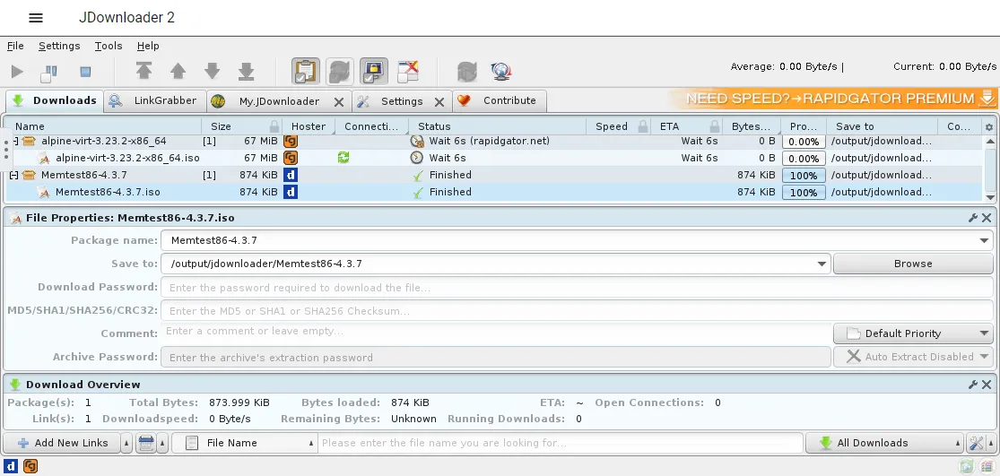

# App JDownloader 2 pour Home Assistant

[Présentation du dépôt](../README.md) · [English guide](en.md)

## Installer depuis le Store Home Assistant

1. Dans Home Assistant, ouvre **Paramètres → Applications → Installer une application → Dépôts**.
2. Ajoute `https://github.com/r-jean-pierre/home-assistant-jdownloader-app`.
3. Sélectionne **JDownloader 2**, puis clique sur **Installer** et **Démarrer**.
4. Depuis la page de l’App, clique sur **Ouvrir l’interface Web**. Active **Afficher dans la barre latérale** pour y accéder plus vite.

Home Assistant ouvre le bureau via Ingress. Le Store utilise une image précompilée pour ton architecture depuis GitHub Container Registry.

## Choisir la destination des téléchargements

| Emplacement | Chemin |
| --- | --- |
| Destination par défaut dans JDownloader | `/output/jdownloader` |
| Dossier correspondant dans Home Assistant | `/share/jdownloader` |
| Réglages et historique persistants de l’App | `/config` |

Pour le stockage local, laisse la destination par défaut dans JDownloader. Vérifie la destination du paquet concerné si un téléchargement arrive dans un autre dossier.

### Utiliser un partage SMB

1. Dans Home Assistant, ouvre **Paramètres → Système → Stockage → Ajouter un stockage réseau**.
2. Saisis `jdownloader` comme **Nom**, choisis **Partage** comme **Utilisation**, puis **Samba/Windows (CIFS)**.
3. Dans **Serveur**, indique le nom d’hôte ou l’adresse IP du serveur SMB. Dans **Partage distant**, indique le nom du partage exporté par le serveur. Utilise un compte autorisé à écrire sur ce partage.
4. Démarre l’App et télécharge un petit fichier dans `/output/jdownloader`. Lorsqu’il est marqué **Terminé** dans JDownloader, vérifie sa présence et sa taille sur le serveur SMB.

Les [instructions sur les droits CIFS](../jdownloader/DOCS.md#cifs-write-permissions) détaillent les permissions utilisées par cette version.

## Configuration et mises à jour

L’App du Store garde ses réglages et son historique dans son propre volume `/config`. Fais une sauvegarde de l’App avant une migration. Si le prototype local `local_jdownloader` est installé, l’App du Store démarre avec une configuration distincte. Arrête l’ancienne instance avant d’importer les réglages ou de lancer la même file de téléchargements dans l’App du Store.

## Dépannage

- **L’installation affiche `401 Unauthorized`.** Vérifie que le package conteneur `home-assistant-jdownloader-app` dans GitHub Packages est public et porte le tag d’image correspondant à la version de l’App, par exemple `0.1.6`.
- **Le bureau ne s’ouvre pas.** Vérifie que l’App tourne, puis clique sur **Ouvrir l’interface Web** depuis Home Assistant. Consulte le journal de l’App si la page ne charge toujours pas.
- **Un téléchargement terminé est absent du serveur SMB.** Vérifie l’état du stockage réseau dans Home Assistant, la destination du paquet dans JDownloader et les droits d’écriture côté serveur.
- **Un téléchargement demande un captcha.** Tu peux lier un compte dans les réglages MyJDownloader de JDownloader pour utiliser le [service MyJDownloader](https://my.jdownloader.org/).

Consulte la [politique de sécurité](../SECURITY.md) pour signaler une vulnérabilité et les [notices des logiciels tiers](../NOTICE.md) pour les composants de l’image.
